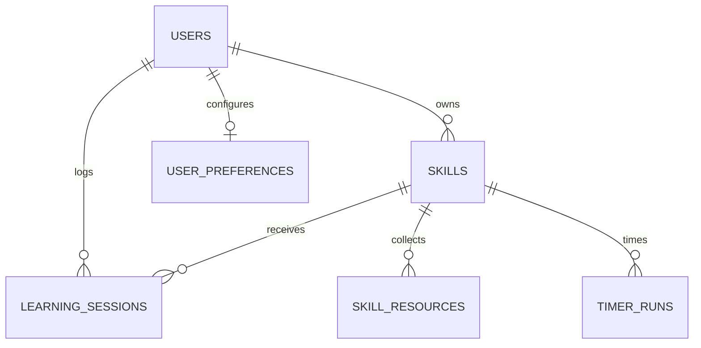

# Growth Board: proposed database design

This is a design only. The running tracker uses browser local storage under `progress.skills-tracker.v1`. There is no database connection, authentication, or cloud sync. The SQL beside this file is illustrative and is not a migration.

## The records

| Table | Purpose | Example |
| --- | --- | --- |
| `users` | Future account and preferred time zone | A learner in America/Toronto |
| `skills` | A named skill, its card slot and colour | Spanish, slot 0 |
| `skill_resources` | Optional named links, many per skill | A course and a reference guide |
| `learning_sessions` | The source of truth for learning progress | Spanish, 25 minutes, November 14 |
| `timer_runs` | A running timer and its deadline | Started 14:00, ends 14:25 |
| `user_preferences` | When the reminder was dismissed | Hide it for another 48 hours |

A skill can have many sessions. Every session belongs to the same user as its skill; the composite foreign key enforces this. A completed timer creates one session using the timer's ID, preventing duplicate completion across tabs.

The six-skill limit is per user, not a limit on sessions. Database checks cannot count other rows safely: a future server must lock the user's row in a transaction, count their skills, and insert only when fewer than six exist. The draft trigger shows this rule. Card slots 0–5 and a unique `(user_id, slot)` constraint also enforce the six-slot layout. No archive/delete flow is implemented yet.

## Calculate progress instead of storing counters

- **Hours per skill:** sum its sessions' `duration_seconds`.
- **Most practised:** the skill with the largest total. Ties use the oldest skill, then its slot.
- **Overall streak:** consecutive distinct `activity_date` values across all skills. Multiple sessions on one day count once. Yesterday's streak stays alive until the end of today; after a missed full day it resets.
- **Individual streak:** the same calculation filtered to one skill.
- **Weekly heatmap:** sum learning time for each Monday–Sunday week. The displayed month boundaries clip the first and last weeks; tooltips show the actual interval. With no sessions the current month appears; otherwise the current and previous two months appear. Arrow controls move the window by one month. The monthly scale becomes available when the history spans a calendar-month boundary, and the annual scale after twelve calendar months. These scales aggregate actual time by month and year; clicking a bucket returns to a finer scale. Navigation is bounded by the earliest saved skill creation date or logged activity date, since there is no account creation date yet.

Dates are calendar dates, while timestamps are instants. Logging uses the browser's local date and records its time zone. A timer records the scheduled completion date in the browser's current local time; an early finish records actual elapsed time (minimum one minute). Timers span reloads and are recovered when the tracker is reopened. If a timer crosses midnight, its time is assigned to the completion day rather than split between days.

## Current app files

| File | Responsibility |
| --- | --- |
| `app/growth-board/page.tsx` | Dedicated header, skill cards, totals, greeting streak and timer |
| `app/growth-board/ActivityChart.tsx` | Adaptive weekly, monthly and annual activity scales with drill-down and bounded navigation |
| `app/growth-board/PracticeDonut.tsx` | Interactive time distribution with hover details and keyboard selection |
| `app/growth-board/SkillDetail.tsx` | Selected skill, resources, time spent and recent sessions |
| `app/growth-board/ThemeToggle.tsx` | Animated light/dark switch, with a separate local preference and cross-tab updates |
| `app/growth-board/StreakFlame.tsx` | Active streak glow and increase animation, respecting reduced motion |
| `app/growth-board/SkillResources.tsx` | Resource section for each card: add, open and remove named learning links |
| `app/growth-board/SkillComposer.tsx` | Inline skill creation, reused in cards and the session form |
| `app/growth-board/SessionDialog.tsx` | Log time or start a timer, with a custom skill picker |
| `app/growth-board/model.ts` | Data types, validation and progress calculations |
| `app/growth-board/storage.ts` | Local storage subscriptions, writes, timer recovery and backup export |
| `app/growth-board/tracker.module.css` | White/green styling, responsive layout and motion |

The original mock `/dashboard` remains separate. The new tracker starts empty and never imports mock sessions. Web Locks serialize writes between tabs where supported; browsers without Web Locks use synchronous writes (simultaneous cross-tab edits may conflict). Corrupt saved data is not silently replaced. Use the download icon to export the stored JSON as a backup. There is no import screen yet.

The dismissible sync reminder returns 48 hours after dismissal while the tracker is open or on the next visit. It is an in-app hint, not a system notification. It explicitly says that sign-in and sync are coming soon. Clearing this site's browser data removes the tracker.

## Later, when accounts exist

The server will derive `user_id` from a verified session, never trust one sent by the client, and authorize every read and write. Account ownership and provider credentials belong in the future authentication system. Before connecting this schema, plan local-data import, conflicts, backups, deletion, and row-level access policies. None of those services are active now.

Learning resources are optional and saved with each skill in local storage. Older saves without a `resources` field remain valid. The resource section supports multiple links, opens them in a new tab, and lets you remove saved links. Only HTTP/HTTPS URLs without embedded credentials are accepted. Resources do not affect learning totals or streaks.

The skill grid displays existing cards in saved order followed by exactly one Add a skill card, until all six slots are used. The donut only allocates segments to skills with recorded learning time; its centre shows total learning time and the leading skill remains named below. Flame icons are orange for active streaks, flare when a count increases during use, and celebrate the overall streak once on the first active visit of each local day.

The tracker palette lives in CSS variables in `tracker.module.css`: yellow surfaces, red/brown text and warm chart colours. The header Log session button retains its green styling. The shared duration dial accepts scoped CSS colour variables, with green defaults for the original dashboard.

Dark mode uses `#0B1D51` as its background, lighter navy surfaces, pale text and gold accents. The preference is saved separately under `progress.skills-tracker.theme`; the root layout restores it before hydration to avoid a bright light-theme flash. Dark styling is scoped to the tracker, and dialogs, charts and native date fields follow the same theme. The navbar toggle works with keyboard input and respects reduced-motion preferences. Recent sessions follow the content directly, without a viewport-height spacer.

The most practiced card includes the latest session across all skills (skill name, date, duration and optional notes) and the overall streak across all skills. The greeting only contains the greeting. Each skill card keeps its own streak. On mobile, the theme control displays a single current-theme icon with a rotation and fade; the sliding sun/moon switch remains on desktop.

Skill backgrounds and donut segments use the same six colours in both themes: `#640D5F`, `#B12C00`, `#EB5B00`, `#090040`, `#471396` and `#B13BFF`. Each card uses a contrasting foreground; the resource dialog keeps the app theme rather than inheriting the card text colour. Colour is assigned by card slot, including skills saved before this palette was added.

The most practiced card centres the overall streak. Its first daily celebration uses a separate local day marker, leaving session data untouched. Individual skill streaks remain on the skill cards. Reduced motion suppresses the celebration.

Latest session is selected across all skills by practice date, with the logging timestamp breaking ties on the same date. The most practiced skill is still selected independently by total learning time.

Selecting a donut segment filters Activity and replaces the skill grid with that skill’s detail card. Hovering or focusing a segment shows its name, time and percentage of all learning time. Enter or space selects it. All skills, or selecting the active segment again, clears the selection. The overall streak and latest session remain global. The donut shows the selected skill’s direct practice and immediate subskills; each subskill includes time from its descendants. These slices partition the total without counting sessions twice. Selection is temporary and does not write to local storage.

The dashboard columns align at the top rather than stretching each other. This keeps the summary card’s height independent of the filtered detail panel. Its normal view has a taller 560px baseline with extra space between the chart, latest session and overall streak. The active timer still uses the compact layout.

The navbar scrolls away with the page. Once outside the viewport it slides back in after upward scrolling, then hides on downward scrolling. A small movement threshold avoids jitter. Its original space is reserved to prevent layout jumps, and hidden controls are inert.

## nested skills

Skills have an optional `parent_id` pointing to another skill owned by the same learner. A null parent means a top-level skill. The six-card limit applies only to active top-level skills. Subskills can nest at any depth; names are unique among active siblings. Local saves without a parent remain top-level skills.

Sessions always belong to the exact skill practiced. Parent totals and streaks include descendants, calculated when reading rather than duplicated in storage. Direct practice stays separate in each donut breakdown. Resources and descriptions belong to individual skills. Archived or deleted descendants still contribute earned time. Archiving or deleting a parent also deactivates descendants; restore parents before individual subskills. A running timer anywhere in the branch prevents deactivation.

A future database implementation must reject cycles and active children under inactive parents in a transaction. The SQL remains a design draft; this feature uses local storage only.
